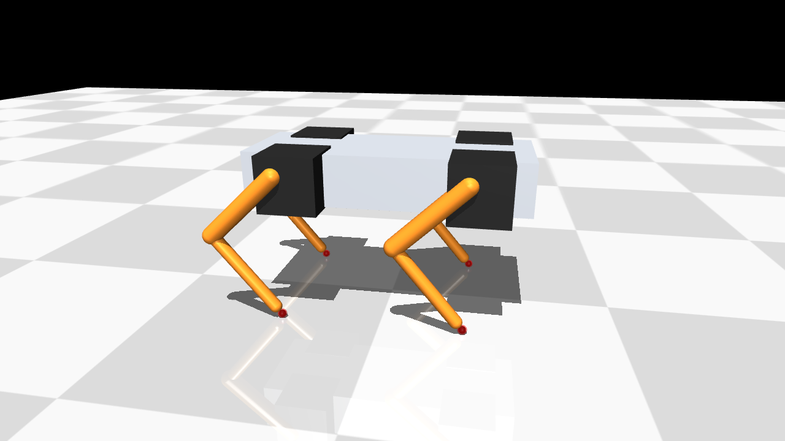

# Adaptive quadruped gait

A 12-joint, four-legged robot trots in the MuJoCo simulator and adapts its gait to uneven ground it has never seen.
A small Q-table (a lookup table of "how good is each action here") is trained in simulation first.
It then keeps learning from the robot's own sensors (IMU and foot contacts) on the new ground.
Its actions nudge gait settings (step height, body lean, stride length), never raw joint angles.
The learner is fixed-point C, small enough to run and learn on a Cortex-M4 microcontroller (STM32F446RE).

Earlier work: the learner benchmark this repo starts from, tag
[`benchmark-v1`](https://github.com/pillanagrovi1/Gait_adaptive_robot/tree/benchmark-v1).

**Status: Stage 1 done** — the robot is measured from its CAD, modelled in MuJoCo and stands
(gate numbers in [`docs/results.md`](docs/results.md), the robot in [`docs/robot.md`](docs/robot.md)).



## Build and test

```
bash scripts/setup_ubuntu.sh      # once: compilers, QEMU, Python environment
source .venv/bin/activate         # every new terminal
make test                         # C tests + Python tests
make -C tools/qemu_plugin         # once: QEMU instruction counter
python3 scripts/measure_m4.py smoke --check   # same learner on an emulated Cortex-M4 == laptop, bit for bit
python3 scripts/stage1_report.py              # Stage 1 gate: stand test at every servo delay
```

Re-measuring the robot needs the reference design unzipped to `~/reference/quadruped/` (not in this repo)
and `pip install -r requirements-reference.txt`; then run `measure_reference.py`, `mass_table.py`,
`knee_linkage.py`, `make_model.py` in `scripts/`.

## Layout

```
models/     quadruped.xml (MuJoCo model) and the measured numbers it is built from
configs/    robot.json: every assumed number, with its source
docs/       robot.md, architecture.md, decisions.md, results.md, study/
c/          the Q-table learner (fixed point, no malloc) and its tests
m4/         Cortex-M4 firmware: benchmark build and processor-in-the-loop build
python/     quad/ (model loader, servo model, sensors, standing pose); tinyrl/ (C binding, corridor reference)
scripts/    robot measurement, model generation, stand test, renders, M4 measurement, Ubuntu setup
tools/      QEMU plugin that counts instructions
```
