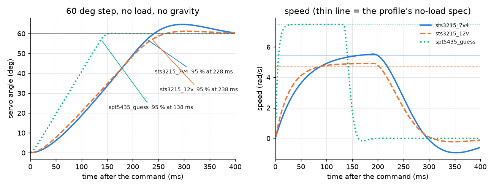
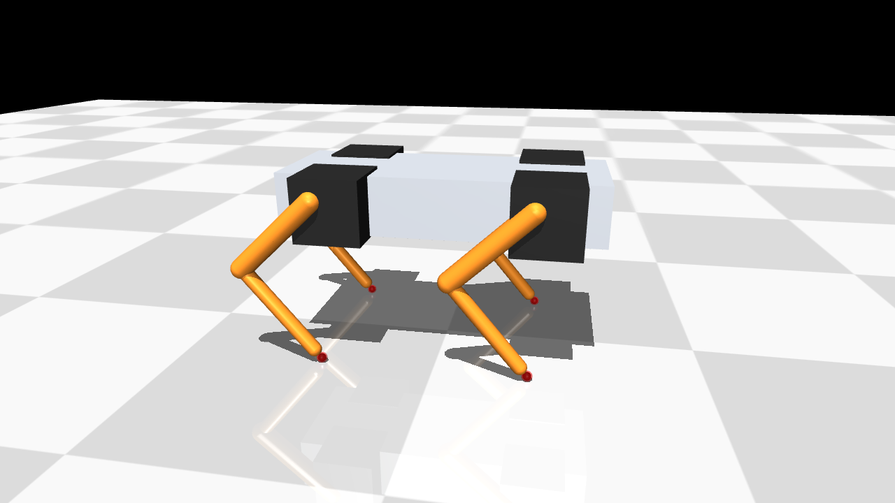

# Results

## Stage 1.1: feedback servos (25 Nov 2026)

Reproduce: `python3 scripts/stage1_1_report.py` (writes `results/stage1_1.json` and the plot). CI runs the same tests
(`python/tests/test_stage1_1.py`, `test_model.py`). Simulation only; every number below was measured in this repo's simulation.

### Servo step test: one servo in the air, no gravity, no load, a 60° step

Gate: peak speed within 15 % of the profile's own no-load speed. **Passed for all three.**

| Profile | Peak speed | Profile's no-load speed | Off by | Time to 95 % | Overshoot |
|---|---|---|---|---|---|
| `sts3215_7v4` (measured reference) | 5.53 rad/s | 5.45 (published, seller) | +1.5 % ✅ | 228 ms | 4.6° |
| `sts3215_12v` (default; **derived**) | 4.92 rad/s | 4.72 (published, seller) | +4.2 % ✅ | 238 ms | 1.2° |
| `spt5435_guess` | 7.48 rad/s | 7.48 (derived from seller) | 0.0 % ✅ | 138 ms | 0.2° |

Before this stage the old servo reached only about 5.2 rad/s of its 7.48 (the speed limit was counted twice, D17). Now it reaches 7.48.

### Delay test: the same step with a command delay

Gate: the motion starts later by the delay, within one physics step + one control tick (21 ms). **Passed for all three profiles:**
the start moved by exactly 10, 20, 40, 60 and 80 ms.

### Stand test: default profile `sts3215_12v` (derived, not measured), 10 s, flat ground, every delay

The default is the 12 V servo since D19. Its numbers are **derived** from the measured 7.4 V model, not measured themselves.
**Gate passed at every delay (10, 20, 40, 60, 80 ms); the numbers are identical at all five** (the command never changes while standing).

| Check | Result | Gate |
|---|---|---|
| Highest servo torque | 0.316 N·m = 10.8 % of stall (2.94 N·m) (FR knee servo) | under 50 % of stall ✅ |
| Against the rated (continuous) torque, 0.98 N·m | up to 32.2 % (knee servos 30.8-32.2 %, hip pitch 28.0-29.4 %, hip roll 13.0-13.9 %) | no servo above 50 % of rated ✅ |
| Body height | starts at 160.0 mm, sinks 2.4 mm in the first second, then creeps 0.30 mm in 9 s (0.30 mm in 29 s: it settles) | — |
| Body tilt | at most 0.032° | — |
| Self-collision / anything but the feet on the floor | none / none | none ✅ |

Per servo, peak over the 10 s (N·m, % of the 2.94 N·m stall, % of the 0.98 N·m rated torque):

| Leg | hip roll | hip pitch | knee servo |
|---|---|---|---|
| FL | 0.136 (4.6 %, 13.9 %) | 0.287 (9.8 %, 29.3 %) | 0.315 (10.7 %, 32.1 %) |
| FR | 0.135 (4.6 %, 13.7 %) | 0.289 (9.8 %, 29.4 %) | 0.316 (10.8 %, 32.2 %) |
| RL | 0.129 (4.4 %, 13.1 %) | 0.275 (9.3 %, 28.0 %) | 0.302 (10.3 %, 30.8 %) |
| RR | 0.128 (4.3 %, 13.0 %) | 0.276 (9.4 %, 28.1 %) | 0.303 (10.3 %, 30.9 %) |

The torques are almost the same as with the 7.4 V servo (same robot, same weight); what changes is the servo's reserve.

#### Reference: the same stand with the measured `sts3215_7v4` profile (first run of this stage, 20 ms; same at every delay)

Max 0.318 N·m = 16.7 % of its 1.91 N·m stall ✅, but **up to 65 % of its 0.49 N·m rated torque: 8 of 12 servos above 50 % of rated** ⚠️.
Sink 3.7 mm (softer gain, 13.4 vs 20.6 N·m/rad). This flag is why the default moved to 12 V (D19).

| Leg | hip roll | hip pitch | knee servo |
|---|---|---|---|
| FL | 0.136 N·m (7.1 % stall, 28 % rated) | 0.289 (15.1 %, 59 %) | 0.317 (16.6 %, 65 %) |
| FR | 0.135 (7.0 %, 28 %) | 0.290 (15.2 %, 59 %) | 0.318 (16.7 %, 65 %) |
| RL | 0.129 (6.8 %, 26 %) | 0.277 (14.5 %, 57 %) | 0.305 (16.0 %, 62 %) |
| RR | 0.128 (6.7 %, 26 %) | 0.279 (14.6 %, 57 %) | 0.307 (16.0 %, 63 %) |

### The 2.5 % hip-torque gap from Stage 1: found

Stage 1's refined hand check put the tibia's weight on the hip servo at the tibia's own centre of mass.
But the knee servo holds the tibia's angle (through the push-rods), so the tibia's weight reaches the hip servo **at the knee**:

    hip torque = W x (K - H) - m_tibia g x (K - H) - m_femur g x (femur COM - H)      (Stage 1 used the tibia COM in the middle term)

With that change the hand check matches the simulation to 0.0001 N·m on all four legs (default profile, FL hip: hand 0.2875,
sim 0.2875; the Stage 1 formula gives 0.2953, 2.7 % high). The check runs with gear friction switched off, because friction can hold part of a
static load. `python3 scripts/stage1_report.py` prints both. The candidate in the prompt (bellcrank and long-rod mass lumped onto
the femur) cannot explain a hand-vs-sim gap, because both use the same lumped model; it is a model-vs-real-robot question
(listed in [model_card.md](model_card.md#known-limits)).

### Joint feedback

`Sensors.observe()` now returns joint angle, speed and `load_frac` (12 each), one control tick late. Tests check the shapes,
the units, the 4096-step quantisation, the one-tick delay, and that no `truth()` value appears in `observe()`.

## Stage 1: the robot stands (24 Nov 2026)

These are the Stage 1 numbers, with the old servo model (SPT5435LV, 65 g servos, rate limiter). Superseded by Stage 1.1 above; kept as a record.

Test: the standing pose (hips 160 mm up, feet under the hips) held for 10 s on flat ground, through the full servo model.
Reproduce: `python3 scripts/stage1_report.py` (writes `results/stage1_stand.json`). CI runs the same test at every delay.

**Gate: passed at every command delay (10, 20, 40, 60, 80 ms).** The numbers below are identical at all five delays:
the command never changes while standing, so the delay has nothing to delay. Delay matters once the robot moves (Stage 2).

| Check | Result | Gate |
|---|---|---|
| Highest servo torque | 12.6 % of stall (FR knee servo, during the first second) | under 50 % ✅ |
| Highest torque after the first second | 10.0 % of stall (FR knee servo) | under 25 % sustained guide ✅ (no joint flagged) |
| Body height | starts at 160.0 mm, sinks 1.9 mm in the first second, then drifts 0.000 mm | — |
| Body tilt | at most 0.044 deg | — |
| Self-collision | none | none ✅ |
| Anything but the feet touching the floor | none | none ✅ |

The 1.9 mm sink is the servos' proportional gain: they need a small angle error (about 0.5 deg) to produce the holding torque.

Per servo (N.m, and % of the 3.4 N.m stall; "after 1 s" = steady holding):

| Leg | hip roll | hip pitch | knee servo | hip pitch after 1 s | knee servo after 1 s |
|---|---|---|---|---|---|
| FL | 0.146 (4.3 %) | 0.389 (11.4 %) | 0.422 (12.4 %) | 9.1 % | 9.9 % |
| FR | 0.145 (4.3 %) | 0.393 (11.6 %) | 0.428 (12.6 %) | 9.2 % | 10.0 % |
| RL | 0.136 (4.0 %) | 0.357 (10.5 %) | 0.396 (11.6 %) | 8.6 % | 9.4 % |
| RR | 0.135 (4.0 %) | 0.364 (10.7 %) | 0.403 (11.8 %) | 8.6 % | 9.4 % |

## Hand check of the holding torque

The foot pushes up with force W. The knee servo turns the tibia about the knee; the hip servo turns the femur about the hip
(the tibia moves with it without turning, because the push-rods hold its angle). So:

- knee servo torque ≈ W x (horizontal distance knee → foot) = W x 73.8 mm
- hip servo torque ≈ W x (horizontal distance hip → knee) = W x 73.7 mm

| Leg | W = m g / 4 | W, front/rear split | quick estimate (front/rear W) | + legs' own weight | simulated (after 3 s) |
|---|---|---|---|---|---|
| FL hip / knee | 4.56 N | 4.69 N | 0.345 / 0.346 N.m | 0.318 / 0.337 | **0.310 / 0.337** |
| FR hip / knee | 4.56 N | 4.69 N | 0.345 / 0.346 | 0.319 / 0.338 | **0.312 / 0.338** |
| RL hip / knee | 4.56 N | 4.43 N | 0.326 / 0.327 | 0.300 / 0.319 | **0.292 / 0.319** |
| RR hip / knee | 4.56 N | 4.43 N | 0.326 / 0.327 | 0.301 / 0.320 | **0.294 / 0.320** |

(m g / 4 alone gives 0.336 N.m for every joint.)

Why the quick estimate is off, and by how much:
1. **Front/rear split** (±4 %): the centre of mass is 7.2 mm behind the body centre, but the front hips are 20 mm closer to it than the rear hips. The front feet carry 51.4 %.
2. **The legs' own weight** (hip −8 %, knee −2.5 %): the foot force W includes the weight of the femur (42 g) and tibia (27 g), which pull the other way on shorter levers. The knee only feels the tibia; the hip feels both.
3. With both corrections the **knee matches the simulation exactly** (to 0.001 N.m). The **hip is still 0.008 N.m (2.5 %) above** the simulation. The feet have no sideways force (checked: 0.000 N), so that is not it. **Explained in Stage 1.1** (above).

The hip roll servos hold 0.135-0.146 N.m: the feet stand 39 mm outboard of the roll axes. No hand check was asked for these.

## Knee push-rods

Tibia angle vs knee-servo angle: 1:1 within 0.05 deg over the usable range (−83 to +75 deg from the CAD pose). Details in [robot.md](robot.md#the-knee-push-rods).

## Cortex-M4 (from the trimmed C core)

`python3 scripts/measure_m4.py smoke --check`: the Q-table learns bit-identically on the emulated M4 and the laptop for all 3 test configurations.
These are QEMU instruction counts, not timing on a real chip.

| Config | Peak RAM (B) | Instructions per learning step |
|---|---|---|
| corridor table (6 cells x 2 actions) | 516 | 371.6 |
| corridor table + Q(lambda) traces | 1032 | 1068.8 |
