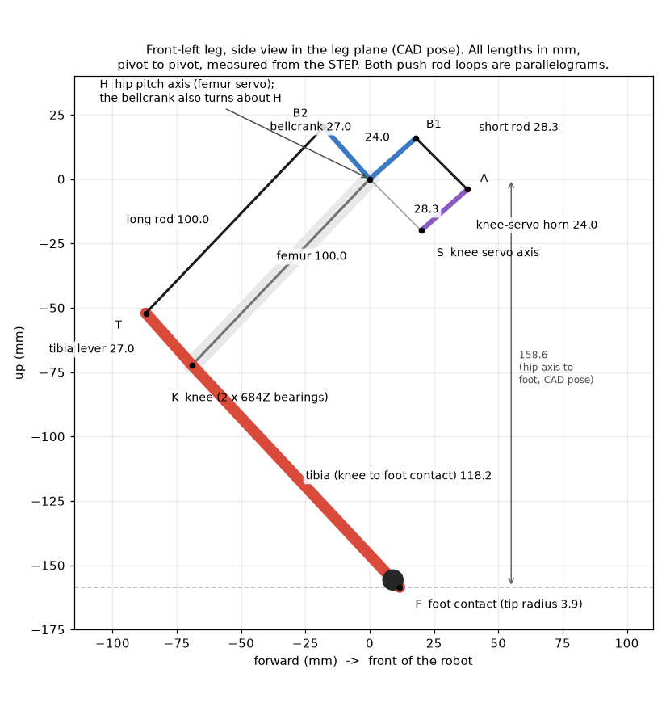
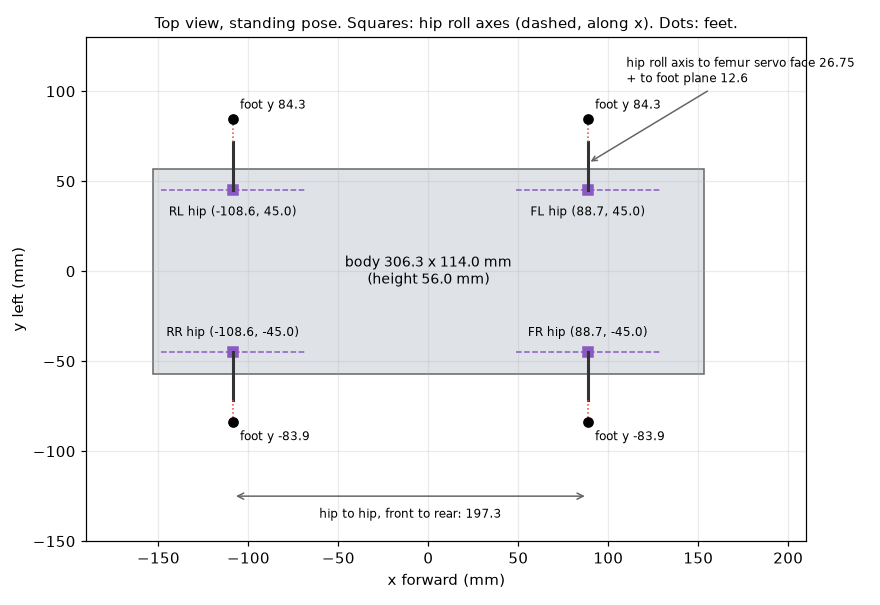
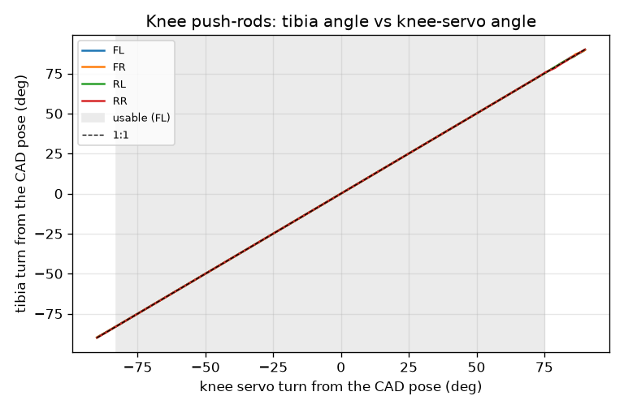

# The robot

How to read the pictures:
- **H** is the hip pitch axis (the femur servo's shaft). **K** is the knee. **F** is where the foot touches the floor.
- Each leg has 3 servos: **hip roll** (in the body, swings the leg sideways), **hip pitch** (swings the femur forward and back), and a **knee servo**.
- The knee servo sits next to the hip, not at the knee. It moves the tibia through two push-rods (the black lines).

## Source

| | |
|---|---|
| Title | "Diy quadruped robot" (GrabCAD, model folder `diy-quadruped-robot-1`) |
| Link | https://grabcad.com/library/diy-quadruped-robot-1 |
| Author | **not confirmed.** A web search lists a GrabCAD model of that name by user "cavicom" (standard RC servos, Orange Pi Zero), but GrabCAD refuses automated page reads, so I could not open the page |
| Licence | **not confirmed** (same reason). Until it is, treat the design as all rights reserved: its files stay out of this repo |
| Files used | the snapshot zip `diy-quadruped-robot-1.snapshot.8.zip`, unzipped to `~/reference/quadruped/` |

The repo holds only numbers measured from these files, never the files.

## How things were measured

Scripts (they need `~/reference/quadruped/`; CI does not):

| Script | Reads | Writes |
|---|---|---|
| `scripts/measure_reference.py` | the STEP assembly | `models/geometry_measured.json` |
| `scripts/dxf_area.py` | the DXF | plate areas (used by the next script) |
| `scripts/mass_table.py` | STEP, STLs, DXF, `configs/robot.json` | `models/mass_measured.json` |
| `scripts/knee_linkage.py` | `geometry_measured.json` | `models/knee_linkage.json`, `docs/img/knee_linkage.png` |
| `scripts/make_model.py` | the three JSON files + config | `models/quadruped.xml` |

Methods, in one line each:
- **An axis** = a cylinder face in the STEP (a shaft or a hole). A servo's shaft is its 2.5 mm spline screw hole.
- **Hip roll axis** = the shaft of the body servo at that corner. **Hip pitch axis** = the shaft of the servo carrying the round horn.
- **Knee axis** = the axis of the two 684Z ball bearings in the tibia (their midpoint).
- **Push-rod joints** = centres of the 5 mm ball joints.
- **Foot** = the tibia tip farthest from the knee. Its radius is a circle fitted to the tip's outline. The STEP tibia already includes the TPU foot (its volume = tibia STL + foot STL).
- **Lengths** are measured in the leg plane (the plane the leg swings in), pivot to pivot.

Frames. The STEP uses x = left, y = up, z = forward. The model uses **x = forward, y = left, z = up**, metres. Same origin (the body centre, at the height of the hip axes).

## Model numbers

`python/tests/test_model.py` checks the model against the rows with a `key` (within 1 mm or 0.5 g).

| Key | Value | Unit | How measured |
|---|---|---|---|
| `femur_mm` | 100.0 | mm | H to K, STEP (all 4 legs: 100.00) |
| `tibia_knee_to_foot_mm` | 118.2 | mm | K to foot contact, STEP (118.21-118.24) |
| `foot_radius_mm` | 3.9 | mm | circle fit to the foot tip, STEP (3.91-3.96) |
| `roll_to_pitch_lateral_mm` | 26.75 | mm | along the pitch axis: roll axis to femur-servo face, STEP |
| `hip_x_front_mm` | 88.65 | mm | front hip pitch axes, x, STEP |
| `hip_x_rear_mm` | -108.65 | mm | rear hip pitch axes, x, STEP |
| `hip_y_mm` | 45.0 | mm | roll axes, distance from the centre line, STEP |
| `hip_z_mm` | 0.0 | mm | roll axes, height in the body frame, STEP |
| `body_length_mm` | 306.3 | mm | front part to rear part, STEP |
| `body_width_mm` | 114.0 | mm | side panels ("gövde"), STEP |
| `body_height_mm` | 56.0 | mm | bottom plate to top plate, STEP (model box: 56.7) |
| `total_mass_g` | 1857.4 | g | table below |

Other measured numbers:

| What | Value | How |
|---|---|---|
| Hip roll axis to hip pitch axis, perpendicular offset | 0.0 mm | STEP: the two axes cross |
| Knee plane, outboard of the femur-servo face | 12.25 mm (RL 12.5) | STEP, bearing midpoint |
| Foot plane, outboard of the femur-servo face | 12.2-12.6 mm | STEP, foot tip |
| Foot, outboard of the roll axis (leg vertical) | 39 mm, so the feet stand 168 mm apart | sum of the two rows above |
| Hip to hip, front to rear | 197.3 mm | STEP |
| Board (Orange Pi Zero) centre, model frame | (-1.2, 36.4, -2.4) mm | STEP; the IMU site is put here |
| Pose in the CAD | hip pitch 43.5-51.4 deg, knee -84.2 to -88.7 deg, legs rolled 13.9-17.8 deg inward | STEP; the four legs differ, so it was posed by hand |
| Hip pitch axis above the foot, CAD pose | 156-162 mm in the leg plane | STEP |

## The knee push-rods

The knee servo **S** turns a horn (24 mm). A 28.3 mm rod links it to a bellcrank that turns freely about the hip axis **H**.
The bellcrank's other arm (27 mm) pushes a 100 mm rod down to a 27 mm lever on the tibia.

| Link | Length (mm) | Its parallel partner (mm) |
|---|---|---|
| knee-servo horn S-A | 24.0 | bellcrank arm H-B1: 24.0 |
| short rod A-B1 | 28.28 | S to H: 28.28 |
| long rod B2-T | 100.0 | femur H-K: 100.0 |
| bellcrank arm H-B2 | 27.0 | tibia lever K-T: 27.0 |

Both loops are **parallelograms** (opposite sides equal). So:
- the tibia turns exactly as much as the knee servo: 1:1. Solving both loops numerically over the servo's travel gives at most **0.05 deg** off 1:1 (slope 0.994 to 1.005, all four legs);
- the knee servo sets the tibia's angle **relative to the body**, not relative to the femur. Moving the femur 30 deg changes the tibia's angle by under 0.003 deg.

Range. Near a "dead point" (when the rod lines up with the link it drives) the linkage cannot push. Keeping 10 deg away from dead points:

| | Range |
|---|---|
| Knee-servo turn from the CAD pose (180 deg servo, centred on the CAD pose: assumed) | -83 to +75 deg (FL; other legs within 4 deg) |
| Tibia pitch (relative to the hip module) | -126 to +32 deg |
| Knee angle (relative to the femur) | -171.5 to -11.5 deg (dead points at -1.5 and -181.5 deg) |

**In the model the knee is a direct hinge** between femur and tibia, with that range. The knee servo is a position actuator on a fixed tendon `hip_pitch + knee` (= tibia pitch), so it gets the same torque, speed and damping as the real servo, 1:1. The rods and bellcrank themselves are not simulated; their mass is added to the femur (bellcrank, long rod) and hip module (short rod).

## Joints

Zero pose: leg vertical, femur straight down, tibia straight down. Signs: hip roll + = rotation about +x; hip pitch and knee + = foot moves backward.

| Joint | Axis | Range (deg) | Why |
|---|---|---|---|
| hip roll | x | -90 to +90 | servo travel, centred on the leg hanging vertically (assumed) |
| hip pitch | y | 43.7 +- 90 (FL) | servo travel, centred on the CAD pose (assumed) |
| knee | y | -171.5 to -11.5 | push-rod dead points, 10 deg margin |
| knee servo (tendon: pitch + knee) | | -126.1 to +31.9 (FL) | push-rod dead points and servo travel |

Not checked: parts hitting each other inside these ranges (no detailed collision shapes yet).

## Masses

Total **1857.4 g**. Every part, its rule and its body: `models/mass_measured.json`. Every density: `configs/robot.json`.

| Group | Count | Mass (g) | Rule |
|---|---|---|---|
| Servos SPT5435LV | 12 | 780.0 | 65 g each (sellers: 62-72 g) |
| Battery packs (3 x 18650 + printed case and cap) | 2 | 314.7 | 47 g per cell + case STL x PLA |
| Screws | 109 | 110.2 | STEP volume x steel |
| Printed parts (PLA; TPU feet inside the 4 tibias) | 28 | 312.1 | STL volume x density x 0.6 infill. All printed STLs by count (one-piece tibias, battery cases included) = 463.8 cm3 solid |
| Aluminium plates | 2 | 130.2 | DXF area x 1.5 mm x 2.70 g/cm3 |
| DC-DC SZBK07 | 2 | 93.7 | STEP volume x 2.70 |
| Push-rods (not in the STEP) | 8 | 28.5 | 3 mm steel rod, ball-centre length |
| Bearings, rod ends, horns | 52 | 50.6 | STEP volume x steel / POM / nylon / aluminium |
| Orange Pi Zero, fan, battery meter, switch | 4 | 37.6 | STEP volume x assumed density |

Per body (g): torso 948.8; each leg: hip module 155.8-159.0, femur 41.6-42.3, tibia 27.1-27.6.
Centre of mass: 7.2 mm behind the body centre, so the front feet carry 51.4 % of the weight.
Each body's inertia comes from its parts' STEP solids, each scaled to its mass (so each part counts as uniform).

Not counted: wires and connectors (not in the CAD).

## Servo, sensors, contact

All in `configs/robot.json` with sources. In short: stall torque 3.4 N.m at 6.0 V, torque limit 0.7 x stall, speed 7.48 rad/s,
deadband 0.36 deg, back-EMF damping 0.45 N.m.s/rad, command delay 20 ms (also run at 10, 40, 60, 80), IMU noise and bias,
foot friction 0.9, physics step 1 ms, control 50 Hz. See [the study page](study/stage1.md) for how the servo model works.
